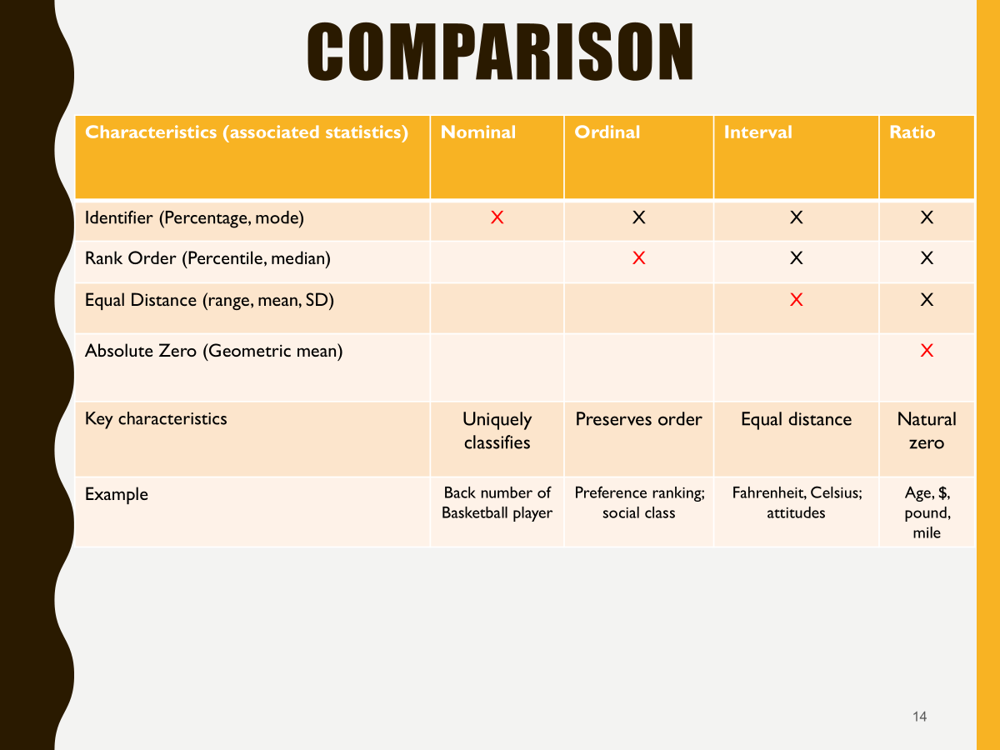

## Overview {.unnumbered}

In this assignment, I prepare survey data from Case 31, Employees Federal Credit Union (EFCU), for analysis using R and Quarto. I read the SPSS data file, inspect it, document the survey variables, fix coding and labeling problems, reverse-code selected items, and decide whether two multi-item measures can be combined into indexes. The questionnaire (Case Exhibit 31.1) and coding instructions (Case Exhibit 31.2) were used throughout.

## Files and software {.unnumbered}

Files in the same project folder as this QMD file:

-   `Case 31 Data_efcu_1.sav`
-   `Case 31 - Employees Federal Credit Union.PDF`

Packages used (installed once from the Console, not inside this document):

``` r
install.packages(c("tidyverse", "haven", "labelled", "janitor", "sjPlot", "psych", "skimr", "gt"))
```

```{r}
#| label: setup

library(tidyverse)
library(haven)
library(labelled)
library(janitor)
library(sjPlot)
library(psych)
library(skimr)
library(gt)
set_theme(theme_minimal())
```

## Four Types of Measurement Scales {.unnumbered}



## Import and inspect the SPSS data

`read_sav()` reads the SPSS file and keeps the variable labels and value labels as metadata. By default (`user_na = FALSE`), values that SPSS flags as user-defined missing are converted to ordinary `NA`.

```{r}
#| label: import
data_raw <- read_sav("Case 31 Data_efcu_1.sav")
```

```{r}
#| label: inspect
dim(data_raw)
names(data_raw)
glimpse(data_raw)
skim(data_raw) # descriptive statistics, including missing values
summary(data_raw) # Min, Max
```

```{r}
#| label: missing-raw
data_raw |>
  summarise(across(everything(), \(x) sum(is.na(x)))) |>
  pivot_longer(everything(), names_to = "variable", values_to = "n_missing") |>
  filter(n_missing > 0)
```

Check whether the two extra variables are simply the mean of q3 to q6:

```{r}
#| label: check-precomputed
data_raw |>
  mutate(q3_q6_mean = rowMeans(pick(q3:q6))) |>
  summarise(
    identical_to_each_other = all(OverallEmployeePerformace == employeeperformance),
    equal_to_q3_q6_mean = all(abs(OverallEmployeePerformace - q3_q6_mean) < 1e-9)
  )
```

### Questions to answer

::: {.callout-tip title="My answers"}
1.  **Rows and columns:** The data have **128 rows** (respondents) and **34 columns** (variables).
2.  **Variable names:** `q3`–`q27`, `q30`–`q34`, `q37`, `q38`, plus `OverallEmployeePerformace` and `employeeperformance`. Questions 1, 2, 28, 29, 35, 36, 39, and 40 are not in the file (screening, check-all-that-apply, and open-ended questions).
3.  **Questionnaire items vs. precomputed variables:** The 32 variables named `q` + number match questions in Exhibit 31.1. `OverallEmployeePerformace` and `employeeperformance` do not match any question, have no variable label, and take values in steps of 0.25 (2.75, 3.00, ..., 5.00). The check above shows they are identical to each other and equal to the mean of q3–q6, so they are precomputed composites, not survey responses.
4.  **Variable label vs. value label:** A *variable label* describes the whole variable (e.g., q4 = "employees are helpful"). A *value label* describes what one numeric code means within that variable (e.g., for q4, 1 = "Strongly Disagree", 5 = "Strongly Agree").
5.  **Missing values:** Only three variables have missing values: **q7 (10)**, **q8 (21)**, and **q37 (7)**. These are the three items with a "No opinion" option, so the `NA`s most likely represent "No opinion" or skipped answers. However, q12 also contains 22 responses coded **3 ("no answer")**, which are missing data hidden as a numeric code (see Section 4.1).
:::

## Create a data dictionary

```{r}
#| label: dictionary
data_dictionary <- tibble(
  variable = names(data_raw),
  variable_label = map_chr(data_raw, \(x) attr(x, "label") %||% ""),
  class = map_chr(data_raw, \(x) class(x)[1]),
  n_distinct = map_int(data_raw, n_distinct),
  value_labels = map_chr(
    data_raw,
    \(x) {
      labs <- attr(x, "labels")
      if (is.null(labs)) "" else str_c(labs, "=", names(labs), collapse = "; ")
    }
  )
)

data_dictionary |> gt()
```

```{r}
#| label: dictionary-easy
data_raw |> view_df()
```

### Questions to answer

::: {.callout-tip title="My answers"}
1.  **Clear, useful labels:** q3–q6 ("Employees are Courteous", "employees are helpful", etc.), q10 ("statement accuracy"), q11 ("statement understandable"), q13–q26 (product/service names such as "IRA" and "new car loans"), and q31–q34 are short but clearly tied to their questions.
2.  **Labels to revise:** q8 is wrong ("statement frequency" duplicates q9, but q8 asks about the rates charged on loans). q7 ("savings rates") and q37 ("overall rating") are vague. q38 ("headquarter") and q27 ("currently have loan") read poorly. Capitalization is inconsistent across items (e.g., "Employees are Courteous" vs. "employees are helpful"). The two precomputed variables have no labels at all. I rewrote all variable labels for consistency in Section 3.3.
3.  **Measurement levels:**
    -   **Nominal:** q11, q12, q27, q38 (yes/no) are categories with no order. q13–q26 (aware and used / aware but not used / unaware) are strictly categories as well.
    -   **Ordinal:** q9 (too often → never) has an order, but the best answer ("About Right") is in the middle, so the codes are not a favorable-to-unfavorable rating.
    -   **Approximately interval:** q3–q6 and q30–q34 are five-point agreement scales; q7, q8 (very high → very low), q10 (excellent → poor), and q37 (excellent → very poor) are ordered rating scales. Strictly they are ordinal, but they are commonly treated as interval so means can be computed.
4.  **Essential vs. predictable value labels:** The labels for q7, q8, q9, q10, q37, and q13–q26 are essential, because the direction is not obvious (1 = "Very High" or "Excellent" is the most positive end, and 6 = "No opinion" is a non-response). For the agreement items, only 1 and 5 are labeled; 2–4 are predictable from the scale, but I added them so the file documents itself. The yes/no labels are predictable, but the "no answer" = 3 code is not and must be documented.
:::

## Improve the metadata with the case coding instructions

### Coding instructions (Case Exhibit 31.2)

| Response scale | Coding |
|------------------------------------|------------------------------------|
| Strongly disagree to strongly agree | Strongly disagree = 1; strongly agree = 5 |
| Very high to very low | Very high = 1; very low = 5; no opinion = 6 |
| Too often to never | Too often = 1; never = 5 |
| Excellent to poor | Excellent = 1; poor = 4 |
| Excellent to very poor | Excellent = 1; very poor = 5; no answer = 6 |
| Yes/no | Yes = 1; no = 2; no answer = 3 |
| Awareness/use | Aware and have used = 1; aware but have not used = 2; unaware = 3 |

Matching it to the questionnaire: q3 to q6 and q30 to q34 are the agreement items; q7 and q8 use very high to very low; q9 is the frequency item; q10 is excellent to poor; q37 is excellent to very poor; q11, q12, q27, and q38 are yes/no; and q13 to q26 are awareness/use items.

::: {.callout-tip title="My answer: codes with no label"}
-   **q13–q26:** code **3 = "Unaware"** has no label. It is used heavily (e.g., 83 respondents in q13 and 78 in q25).
-   **q11, q12, q27, q38:** code **3 = "No answer"** has no label. q12 actually contains 22 responses coded 3.
-   **q3–q6, q30–q34:** only 1 and 5 are labeled; 2, 3, and 4 ("Disagree", "Uncertain", "Agree") are not.
-   **q37:** code 6 is labeled "No Opinion" in the file (matching the questionnaire), while Exhibit 31.2 calls it "no answer". Either way it is a non-response, not a rating.
:::

### Add, edit, and remove labels

```{r}
#| label: label-demo
var_label(data_raw$q7)
val_labels(data_raw$q7)

# Add a label to one code, then strip all value labels
data_raw$q7 |> add_value_labels("Refused" = 7) |> val_labels()

data_raw$q7 |> var_label()
data_raw$q7 |> remove_var_label() |> var_label()
```

### Fixing Metadata Problems

```{r}
#| label: add-labels

# Agreement Likert-type scale value labels
five_pt_likert <- c(
  "Strongly Disagree" = 1,
  "Disagree" = 2,
  "Uncertain" = 3,
  "Agree" = 4,
  "Strongly Agree" = 5
)

data_labelled <- data_raw |>
  mutate(
    across(c(q3:q6, q30:q34), \(x) add_value_labels(x, five_pt_likert))
  )

# Missing "unaware" and "no answer" codes
data_labelled <- data_labelled |>
  mutate(
    across(q13:q26, \(x) add_value_labels(x, "Unaware" = 3)),
    across(c(q11, q12, q27, q38), \(x) add_value_labels(x, "No answer" = 3))
  ) |>
  set_value_labels(
    q37 = c(
      "Excellent" = 1,
      "Good" = 2,
      "Average" = 3,
      "Poor" = 4,
      "Very Poor" = 5,
      "No answer" = 6
    ),
    q38 = c("Yes" = 1, "No" = 2, "No answer" = 3)
  )

# Readable, consistent variable labels based on the questionnaire wording
data_labelled <- data_labelled |>
  set_variable_labels(
    q3  = "Employees are courteous",
    q4  = "Employees are helpful",
    q5  = "Employees are professional",
    q6  = "Employees are always available",
    q7  = "Rates CU pays on share (savings) accounts",
    q8  = "Rates CU charges on loans",
    q9  = "Frequency of account statements",
    q10 = "Accuracy of account statements",
    q11 = "Statements are easy to understand",
    q12 = "CU keeps account information confidential",
    q13 = "Awareness/use: regular share accounts",
    q14 = "Awareness/use: special subaccounts",
    q15 = "Awareness/use: Christmas club accounts",
    q16 = "Awareness/use: individual retirement accounts",
    q17 = "Awareness/use: MasterCard credit cards",
    q18 = "Awareness/use: signature loans",
    q19 = "Awareness/use: new car loans",
    q20 = "Awareness/use: late model car loans",
    q21 = "Awareness/use: older model car loans",
    q22 = "Awareness/use: household goods/appliance loans",
    q23 = "Awareness/use: recreational loans",
    q24 = "Awareness/use: share collateralized loans",
    q25 = "Awareness/use: IRA loans",
    q26 = "Awareness/use: line of credit loans",
    q27 = "Currently has a loan with the CU",
    q30 = "CU loan rates are lower than other institutions",
    q31 = "CU keeps personal financial information confidential",
    q32 = "CU is prompt in processing loan applications",
    q33 = "CU services meet the needs of members",
    q34 = "CU loan applications are simple and easy",
    q37 = "Overall rating of how the CU is managed and operated",
    q38 = "Lives in the headquarters area",
    OverallEmployeePerformace = "Precomputed mean of q3-q6 (not a survey item)",
    employeeperformance = "Precomputed mean of q3-q6 (duplicate, not a survey item)"
  )

val_labels(data_labelled$q13)
val_labels(data_labelled$q11)
val_labels(data_labelled$q37)
var_label(data_labelled$q8)

view_df(data_labelled)
```

::: {.callout-tip title="My answer: relabeling q8"}
In the questionnaire, Question 8 asks: *"What is your opinion about the rates the Credit Union is charging its members to borrow funds?"* It is about **loan rates**, not statement frequency. I relabeled it in the chunk above:

``` r
data_labelled |> set_variable_labels(q8 = "Rates CU charges on loans")
```
:::

## Create an analysis copy

```{r}
#| label: analysis-copy
data <- data_labelled |>
  select(matches("^q\\d+$"))

names(data)
```

::: {.callout-tip title="My answer: why not use a precomputed index"}
The point of this assignment is to *test* whether q3–q6 (and q30–q34) form a reliable, one-dimensional measure before combining them. A precomputed index skips that test. It was built by someone else, with no label or documentation, so I cannot tell how it handled missing values, whether any items were reversed, or whether reliability was checked. Here it was simply the mean of q3–q6, and the file contains it twice. Using it would also double-count the same information if the items were analyzed alongside it. Building the index myself from the raw items keeps the process transparent and reproducible.
:::

### Data-quality checks

```{r}
#| label: quality-checks
data |>
  # Plain numbers are needed to stack columns that have different labels
  mutate(across(everything(), as.numeric)) |>
  pivot_longer(everything(), names_to = "variable") |>
  summarise(
    values_observed = str_c(sort(unique(value)), collapse = ", "),
    n_missing = sum(is.na(value)),
    pct_missing = round(mean(is.na(value)) * 100, 1),
    .by = variable
  ) |>
  gt()
```

::: {.callout-tip title="My answer: undefined values"}
No variable contains a value outside the codes defined in Exhibit 31.2. Every observed value falls in its scale's range (1–5 for agreement and rating items, 1–4 for q10, 1–3 for yes/no and awareness items). Before Section 3.3, however, some of these values were **undefined in the file's metadata**: 3 in q12 and q13–q25 had no label. The issue that still needs fixing is **q12 = 3 ("No answer")**: 22 respondents (17.2%) have a valid-looking number that is really a non-response. If it were left as 3, it would be treated as a third category or, worse, as a higher value than "No". q9 only contains 3 and 4, so it has very little variance.
:::

## Recode special responses and reverse-code items

### "No Opinion" and "No answer" responses

According to Exhibit 31.2, q7 and q8 use 6 for "No Opinion", q37 uses 6 for "No answer", and the yes/no items use 3 for "No answer". None of these is a rating, so all must be treated as missing.

```{r}
#| label: check-no-opinion
data |>
  summarise(
    across(c(q7, q8, q37), \(x) sum(x == 6, na.rm = TRUE)),
    across(c(q11, q12, q27, q38), \(x) sum(x == 3, na.rm = TRUE))
  )
```

There are no 6s left in q7, q8, or q37 (they are already `NA` in the file). q12 has 22 "No answer" codes. The recode below guarantees the correct result either way.

```{r}
#| label: recode-no-opinion
data <- data |>
  mutate(
    across(c(q7, q8, q37), \(x) na_if(x, 6)),
    across(c(q11, q12, q27, q38), \(x) na_if(x, 3))
  )

data |>
  summarise(across(c(q7, q8, q12, q37), \(x) sum(is.na(x))))
```

### Reverse coding

-   q7, q8, and q37: 1 to 5 scales, reversed with `6 - x`
-   q10: 1 to 4 scale, reversed with `5 - x`
-   q9 is not reversed (the best response is in the middle of the scale)
-   q13 to q26 are reversed only in the ordinal version below (Section 5.2.2)

$$\text{reversed} = \text{minimum} + \text{maximum} - \text{original}$$

```{r}
#| label: reverse-code
data <- data |>
  mutate(
    q7r = 6 - q7,
    q8r = 6 - q8,
    q10r = 5 - q10,
    q37r = 6 - q37
  ) |>
  set_variable_labels(
    q7r = "Savings rates (reversed: higher = higher rates paid)",
    q8r = "Loan rates (reversed: higher = higher rates charged)",
    q10r = "Statement accuracy (reversed: higher = better)",
    q37r = "Overall rating (reversed: higher = better)"
  ) |>
  set_value_labels(
    q7r = c(
      "Very Low" = 1,
      "Low" = 2,
      "Average" = 3,
      "High" = 4,
      "Very High" = 5
    ),
    q8r = c(
      "Very Low" = 1,
      "Low" = 2,
      "Average" = 3,
      "High" = 4,
      "Very High" = 5
    ),
    q10r = c("Poor" = 1, "Fair" = 2, "Good" = 3, "Excellent" = 4),
    q37r = c(
      "Very Poor" = 1,
      "Poor" = 2,
      "Average" = 3,
      "Good" = 4,
      "Excellent" = 5
    )
  )
```

::: callout-warning
**Note on q8r:** For q7 (rates the CU *pays* on savings), a higher rate is good for members, so after reversal a larger q7r is more favorable. For q8 (rates the CU *charges* on loans), a higher rate is *bad* for members. After reversal, a larger q8r means members see loan rates as **higher**, which is less favorable. The original q8 is already ordered so that larger = lower loan rates = more favorable. If q8 is combined with favorable-direction items, the original q8 should be used, not q8r.
:::

#### Questions to answer

::: {.callout-tip title="My answers"}
1.  **q9:** The scale runs Too Often (1) → Very Often (2) → About Right (3) → Not Often Enough (4) → Never (5). The ideal answer is in the middle, and both ends are problems for different reasons (too many statements vs. too few). Reversing it would just flip which problem gets the high number, so "larger = better" would still not be true. A better approach is to recode q9 to answer the actual question, "Was the frequency about right?", as a dummy variable: 1 = About Right, 0 = otherwise. It could also be collapsed into three groups: too often (1–2), about right (3), not often enough (4–5). See the chunk below.
2.  **q13–q26:** These are categories describing a member's relationship with each product (used / aware but not used / unaware), not a rating from bad to good. They also cover 14 different products, so they do not measure one construct, and averaging them would mix very different services (e.g., IRAs and car loans) into a meaningless score. A better way to summarize them is with **frequency tables or percentages per product** (e.g., % unaware of each service), or with **dummy variables** such as "aware" (1–2 vs. 3) and "used" (1 vs. 2–3). Counts such as the number of services a member has used can also be computed.
:::

```{r}
#| label: q9-about-right
data <- data |>
  mutate(
    q9_about_right = if_else(q9 == 3, 1, 0),
    q9_group = case_when(
      q9 %in% 1:2 ~ 1,
      q9 == 3 ~ 2,
      q9 %in% 4:5 ~ 3
    )
  ) |>
  set_variable_labels(
    q9_about_right = "Statement frequency is about right (1 = yes, 0 = no)",
    q9_group = "Statement frequency (grouped)"
  ) |>
  set_value_labels(
    q9_about_right = c("Not about right" = 0, "About right" = 1),
    q9_group = c("Too often" = 1, "About right" = 2, "Not often enough" = 3)
  )

data |> count(q9, q9_about_right, q9_group)
```

#### Awareness Items as Ordinal Scale

**Task:** Treat awareness questions (q13 through q26) as an ordinal scale and create new reverse-coded variables so that higher values mean greater awareness/use.

```{r}
#| label: reverse-awareness
aware_scale_3 <- c(
  "Unaware" = 1,
  "Aware but Have Not Used" = 2,
  "Aware and Have Used" = 3
)

data <- data |>
  mutate(
    across(
      q13:q26,
      \(x) labelled(4 - as.numeric(x), aware_scale_3),
      .names = "{.col}r"
    )
  )

# Carry over the original variable labels and note the direction
aware_vars <- paste0("q", 13:26)
var_label(data[paste0(aware_vars, "r")]) <- paste0(
  var_label(data[aware_vars], unlist = TRUE),
  " (reversed: higher = more aware/used)"
)

data |> count(q13, q13r)
var_label(data$q13r)
```

### Verify the recoding

```{r}
#| label: verify-recode
data |> count(q7, q7r)
data |> count(q8, q8r)
data |> count(q10, q10r)
data |> count(q37, q37r)
data |> count(q12)

# Every awareness item: original + reversed should always equal 4
data |>
  summarise(across(
    q13:q26,
    \(x) all(x + data[[paste0(cur_column(), "r")]] == 4, na.rm = TRUE)
  ))
```

::: {.callout-tip title="Verification"}
-   "No Opinion" is missing (`NA`) for q7, q8, and q37, and "No answer" is missing for q12. ✔
-   The lowest original value became the highest reversed value (q7: 2 → 4, 5 → 1; q37: 1 → 5, 5 → 1; q10: 1 → 4, 4 → 1). ✔
-   Missing values stayed missing (`NA` → `NA`). ✔
-   Larger reversed values now mean a more favorable response for q7r, q10r, and q37r, and greater awareness/use for q13r–q26r. q8r is the exception noted above (larger = higher loan rates). ✔
:::

## Evaluate candidate multi-item measures

Two groups of items may form multi-item measures:

1.  Employee proficiency: q3 through q6.
2.  Operational effectiveness: q30 through q34.

### Employee proficiency

```{r}
#| label: employee-alpha
employee_items <- data |>
  select(q3:q6) |>
  remove_val_labels() |>
  remove_var_label()

employee_alpha <- psych::alpha(employee_items)

employee_alpha$total
employee_alpha$alpha.drop
employee_alpha$item.stats
```

```{r}
#| label: employee-fa
employee_fa <- psych::fa(
  employee_items,
  nfactors = 1,
  rotate = "none",
  fm = "minres"
)

employee_fa$loadings
employee_fa$communality
```

### Operational effectiveness

```{r}
#| label: operations-alpha
operations_items <- data |>
  select(q30:q34) |>
  remove_val_labels() |>
  remove_var_label()

operations_alpha <- psych::alpha(operations_items)

operations_alpha$total
operations_alpha$alpha.drop
operations_alpha$item.stats
```

```{r}
#| label: operations-fa
operations_fa <- psych::fa(
  operations_items,
  nfactors = 1,
  rotate = "none",
  fm = "minres"
)

operations_fa$loadings
operations_fa$communality
```

### Questions to answer

::: {.callout-tip title="Employee proficiency (q3–q6)"}
1.  **Reliability:** `raw_alpha` = **0.87**, well above the 0.70 guideline.
2.  **Item-total statistics:** All `r.drop` values are strong (q3 = 0.66, q4 = 0.82, q5 = 0.73, q6 = 0.67). No item is weak or negative, so none needs reversing. Dropping any item would lower alpha (to 0.79–0.85), so every item contributes. q4 ("helpful") is the strongest: removing it causes the biggest drop (0.79).
3.  **Factor loadings:** All four items load highly on one factor (q3 = 0.72, q4 = 0.92, q5 = 0.79, q6 = 0.73), all above 0.70. The single factor explains **63%** of the variance, and all communalities exceed 0.50.
4.  **One-factor interpretation:** Yes. All four statements describe the same thing, how members see CU employees (courteous, helpful, professional, available), and they use the same agreement scale in the same direction.
5.  **Recommendation:** **Create the index.** The statistics (high alpha, strong item-total correlations, strong single-factor loadings) and the item wording both support one construct, *employee proficiency*.
:::

::: {.callout-tip title="Operational effectiveness (q30–q34)"}
1.  **Reliability:** `raw_alpha` = **0.54**, well below 0.70.
2.  **Item-total statistics:** `r.drop` values are weak: q30 = 0.32, q31 = 0.29, q32 = 0.48, q33 = 0.22, q34 = 0.22. None is negative, and all items are worded positively, so reversing is not the problem; the items just do not hang together. Dropping q33 or q34 barely changes alpha (0.53–0.54), meaning they add almost nothing.
3.  **Factor loadings:** They do not support one factor. Only q32 ("prompt in processing loan applications") loads strongly (0.79). The others are low (q30 = 0.40, q31 = 0.38, q33 = 0.30, q34 = 0.35), and the factor explains only **23%** of the variance. Communalities for everything except q32 are under 0.17.
4.  **One-factor interpretation:** No. The items cover different ideas: q30 is about loan-rate competitiveness (price), q31 is about confidentiality (trust), q32 and q34 are about the loan process, and q33 is about overall satisfaction with services. Only q32 (and arguably q34) is really about operational efficiency.
5.  **Recommendation:** **Do not create the index.** Both the statistics and the item meaning show these are separate concepts. I will analyze q30–q34 individually, with q32 as the best single indicator of operational efficiency and the others named for what they measure (e.g., q30 = perceived loan-rate competitiveness, q31 = perceived confidentiality, q33 = services meet needs, q34 = ease of loan application).
:::

### Create indexes only when justified

Only the employee proficiency index is created. The operational effectiveness index is not warranted (Section 6.3), so q30–q34 stay as separate items.

```{r}
#| label: create-indexes
data <- data |>
  mutate(
    employee_proficiency_index = rowMeans(pick(q3:q6), na.rm = TRUE),
    across(ends_with("_index"), \(x) if_else(is.nan(x), NA_real_, x))
  ) |>
  set_variable_labels(
    employee_proficiency_index = "Employee proficiency index (mean of q3-q6; 1 = strongly disagree, 5 = strongly agree)"
  )
```

```{r}
#| label: check-indexes
data |>
  select(ends_with("_index")) |>
  summary()
```

## Report your data-preparation decisions

::: {.callout-note title="Data Preparation Narrative"}
**Import.** The SPSS file was read with `haven::read_sav()`, which kept the variable and value labels. The data have 128 respondents and 34 variables. `data_raw` was kept unchanged as a reference copy, and all cleaning was done on copies.

**Data dictionary.** The dictionary showed that the file's metadata was incomplete. The agreement items only labeled 1 and 5; the awareness items had no label for 3 ("Unaware"); the yes/no items had no label for 3 ("No answer"); and q8 had the wrong variable label (it duplicated q9's "statement frequency" although q8 asks about loan rates). Most items are ordinal rating scales treated as approximately interval (q3–q8, q10, q30–q34, q37), q9 is ordinal with the ideal answer in the middle, and q11, q12, q13–q27, and q38 are nominal.

**Labels.** Using Exhibit 31.2 and the questionnaire, I added the missing value labels ("Disagree"/"Uncertain"/"Agree", "Unaware", "No answer"), relabeled q37's code 6 as "No answer", fixed q8's variable label, and rewrote all variable labels in consistent, readable wording.

**Variables kept or excluded.** `OverallEmployeePerformace` and `employeeperformance` were dropped from the analysis copy. They are not survey questions, are identical to each other, and equal the mean of q3–q6; I rebuilt that measure myself after testing it.

**Missing values.** Only q7 (10), q8 (21), and q37 (7) had system-missing values on import; no 6s ("No opinion"/"No answer") remained in the file. The recode `na_if(x, 6)` was still applied to guarantee the result. The yes/no items use 3 for "No answer", and q12 had 22 such codes; these were converted to `NA` because they are non-responses, not answers.

**Reverse coding.** q7, q8, and q37 were reversed with `6 - x` and q10 with `5 - x`, with new value labels in the reversed direction. q9 was not reversed because the best answer is in the middle; instead I created `q9_about_right` (1 = about right) and a three-group version. q13–q26 were kept as categories, and ordinal reversed versions (q13r–q26r, 1 = unaware, 3 = aware and used) were added for optional ordinal analysis. All recodes were verified with cross-tabulations. One caution: q8 asks about loan rates charged, so q8r = higher loan rates, which is *less* favorable to members.

**Multi-item measures.** Employee proficiency (q3–q6) is reliable (α = 0.87) and unidimensional (loadings 0.72–0.92, 63% variance explained), and the items clearly describe one idea, so I created `employee_proficiency_index` as the mean of q3–q6. Operational effectiveness (q30–q34) is not reliable (α = 0.54), loads weakly on one factor (23% variance explained; only q32 above 0.70), and the items describe different ideas (price, confidentiality, process, satisfaction), so no index was created; these items will be analyzed individually.

**Limitations.** The case says 125 questionnaires were returned and 2 were excluded (one missing pages, one apparently falsified), but the file has 128 rows, so it is unclear whether those cases were removed. The `NA`s in q7, q8, and q37 cannot be told apart as "No opinion" vs. skipped. q9 has almost no variance (only 3 and 4 observed), and q8 has 16% missing, which limits analysis of those items. The operational effectiveness items need a better measure in future surveys.
:::

## Confirming Completeness of Data Wrangling with Data Dictionary

```{r}
#| label: final-dictionary
data |> view_df()
```

## Save your work to a new SPSS file

The cleaned file includes the corrected variable and value labels, missing-value fixes, reverse-coded variables, the q9 recodes, and the employee proficiency index.

```{r}
#| label: save-spss
data |>
  write_sav("Case31_Data_efcu_JE_cleaned.sav")
```

## Appendix: GitHub Pages link

-   [View my GitHub Pages report](https://jakevns.github.io/REPOSITORY/FOLDER/Evans_Jake-IC10-2-1-Data-Preparation-Case-31.html)

-   [GitHub Repo for Case 31](https://github.com/jakevns/REPOSITORY)
