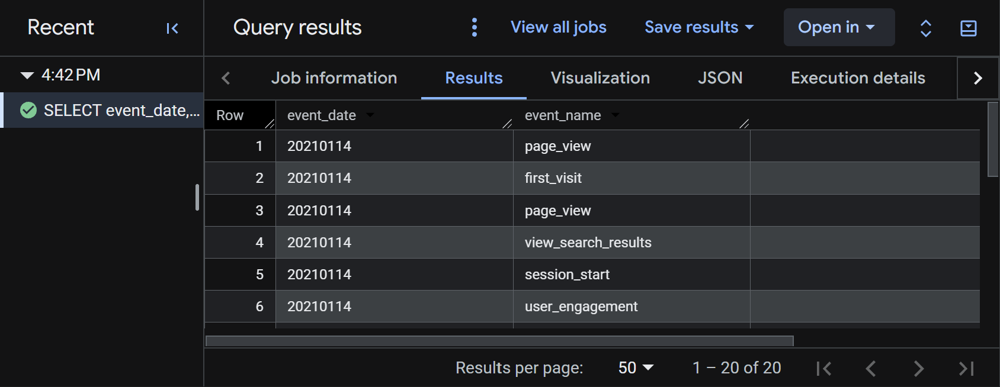
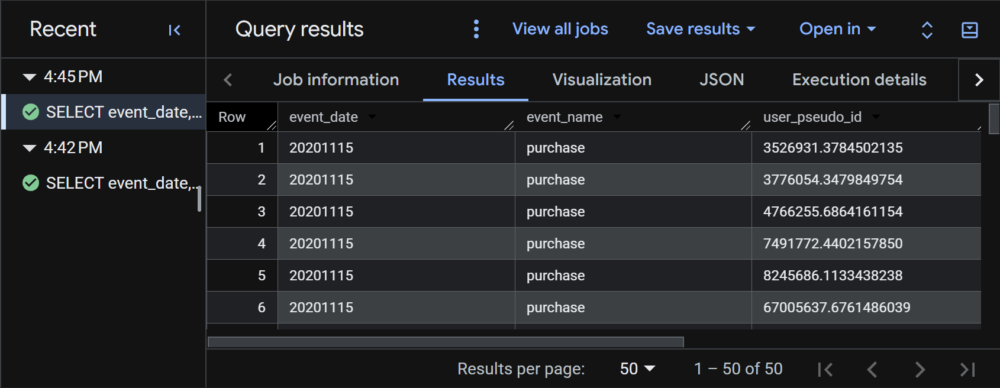
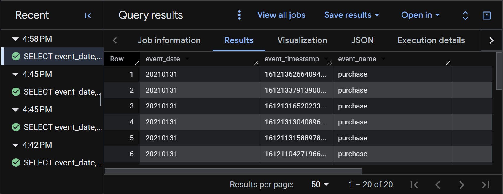
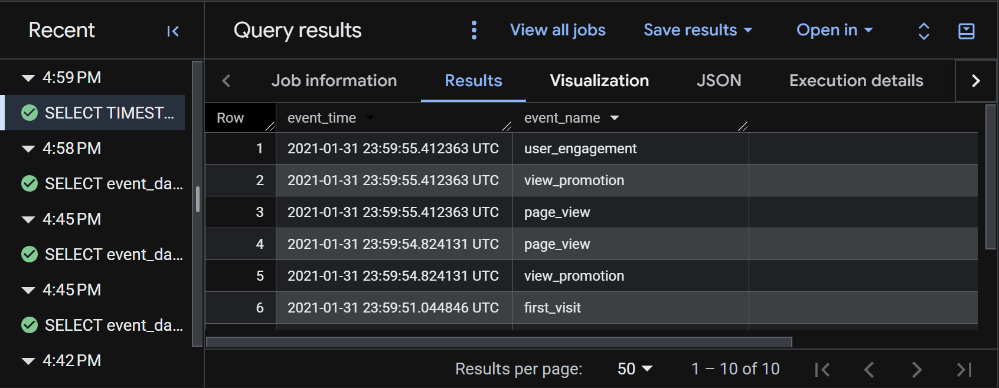
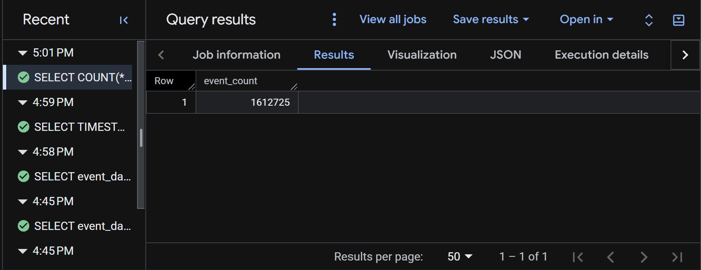
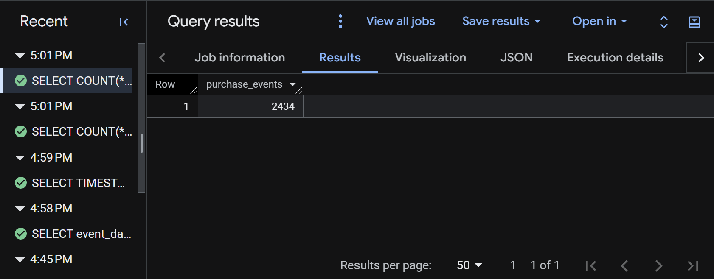
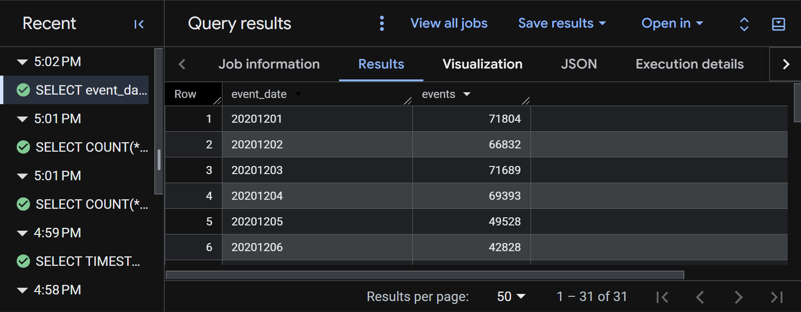
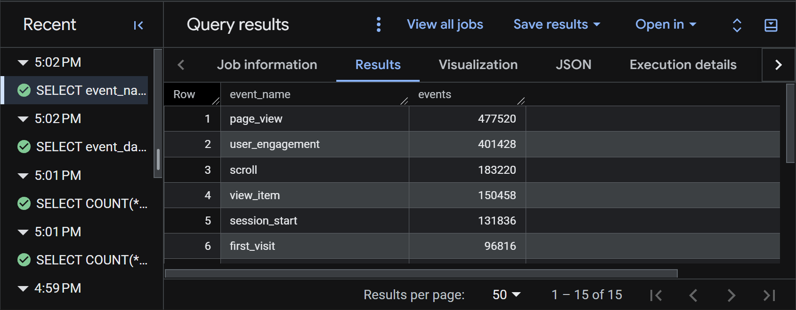
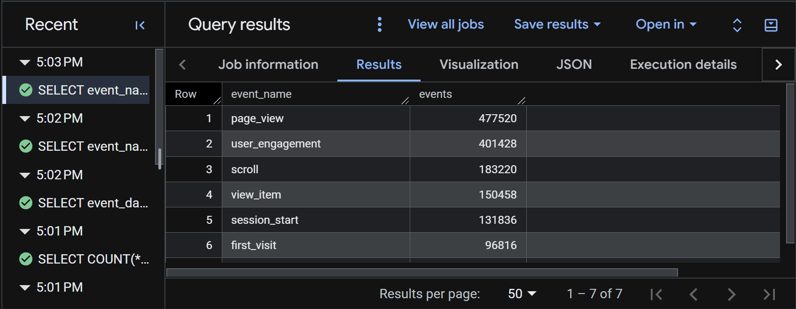
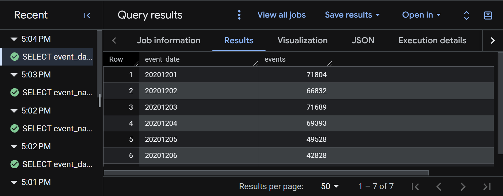

# Overview

This notebook walks through the SQL basics from Lecture 1 using Google BigQuery and the public GA4 sample dataset `bigquery-public-data.ga4_obfuscated_sample_ecommerce`. Each section shows the query, explains what it does, and includes a screenshot of the output from BigQuery.

The [BigQuery Export Schema](https://support.google.com/analytics/answer/7029846) documents variables and nested levels that are not visible in the dataset preview.

# Selecting and Filtering

## SELECT / FROM / LIMIT

``` sql
SELECT event_date, event_name
FROM `bigquery-public-data.ga4_obfuscated_sample_ecommerce.events_*`
LIMIT 20;
```

**What it does:** `SELECT` picks the `event_date` and `event_name` columns, `FROM` points to every daily events table in the dataset, and `LIMIT 20` returns only the first 20 rows. Use it for a quick look at the data structure.



## WHERE Filters Rows

``` sql
SELECT event_date, event_name, user_pseudo_id
FROM `bigquery-public-data.ga4_obfuscated_sample_ecommerce.events_*`
WHERE event_name = 'purchase'
LIMIT 50;
```

**What it does:** `WHERE` keeps only rows where the event is a `purchase`. Adding `user_pseudo_id` shows which (anonymized) user made each purchase. The query returns up to 50 matching rows.



# Sorting Results

## ORDER BY

``` sql
SELECT event_date, event_timestamp, event_name
FROM `bigquery-public-data.ga4_obfuscated_sample_ecommerce.events_*`
WHERE event_name = 'purchase'
ORDER BY event_timestamp DESC
LIMIT 20;
```

**What it does:** Filters to purchase events, then sorts them by `event_timestamp` in descending order (`DESC`), so the 20 most recent purchases show first.



## Readable Timestamps with TIMESTAMP_MICROS

``` sql
SELECT TIMESTAMP_MICROS(event_timestamp) AS event_time,
       event_name
FROM `bigquery-public-data.ga4_obfuscated_sample_ecommerce.events_*`
ORDER BY event_timestamp DESC
LIMIT 10;
```

**What it does:** GA4 stores `event_timestamp` as microseconds since 1970, which is hard to read. `TIMESTAMP_MICROS()` converts it into a normal date-time, renamed `event_time` with `AS`. The query returns the 10 most recent events of any type.



# Aggregate Functions

COUNT, SUM, AVG, MIN, and MAX summarize many rows into a few values.

## Count Total Events in a Date Range

``` sql
SELECT COUNT(*) AS event_count
FROM `bigquery-public-data.ga4_obfuscated_sample_ecommerce.events_*`
WHERE _TABLE_SUFFIX BETWEEN '20201201' AND '20201231';
```

**What it does:** `COUNT(*)` counts every row (event) in the daily tables for December 2020. The result is one number: `event_count`.



## Count Purchases in a Date Range

``` sql
SELECT COUNT(*) AS purchase_events
FROM `bigquery-public-data.ga4_obfuscated_sample_ecommerce.events_*`
WHERE event_name = 'purchase'
  AND _TABLE_SUFFIX BETWEEN '20201201' AND '20201231';
```

**What it does:** Combines two conditions with `AND` to count only purchase events in December 2020.



# Grouping and Filtering Groups

## GROUP BY Controls the Grain

`GROUP BY` sets what one row of the result represents, such as one row per day or one row per event type.

### Events by Day

``` sql
SELECT event_date, COUNT(*) AS events
FROM `bigquery-public-data.ga4_obfuscated_sample_ecommerce.events_*`
WHERE _TABLE_SUFFIX BETWEEN '20201201' AND '20201231'
GROUP BY event_date
ORDER BY event_date;
```

**What it does:** Counts events for each day in December 2020. Each row is one date, sorted from earliest to latest, which shows daily traffic trends.



### Top Event Types

``` sql
SELECT event_name, COUNT(*) AS events
FROM `bigquery-public-data.ga4_obfuscated_sample_ecommerce.events_*`
WHERE _TABLE_SUFFIX BETWEEN '20201201' AND '20201231'
GROUP BY event_name
ORDER BY events DESC
LIMIT 15;
```

**What it does:** Counts events for each event type in December 2020 and lists the 15 most frequent, from highest to lowest.



## HAVING Filters After Grouping

``` sql
SELECT event_name, COUNT(*) AS events
FROM `bigquery-public-data.ga4_obfuscated_sample_ecommerce.events_*`
WHERE _TABLE_SUFFIX BETWEEN '20201201' AND '20201231'
GROUP BY event_name
HAVING COUNT(*) >= 50000
ORDER BY events DESC;
```

**What it does:** `WHERE` filters rows *before* grouping; `HAVING` filters the grouped results *after* counting. This keeps only event types with at least 50,000 events in December 2020.



# Wildcard Tables and \_TABLE_SUFFIX

``` sql
SELECT event_date, COUNT(*) AS events
FROM `bigquery-public-data.ga4_obfuscated_sample_ecommerce.events_*`
WHERE _TABLE_SUFFIX BETWEEN '20201201' AND '20201207'
GROUP BY event_date
ORDER BY event_date;
```

**What it does:** GA4 exports one table per day (e.g., `events_20201201`). The `*` wildcard queries all of them at once, and `_TABLE_SUFFIX` limits the scan to December 1–7, 2020. Scanning fewer tables makes the query faster and cheaper.



# Resources

- SQL file: [Evans_Jake-lecture1-ga4.sql](Evans_Jake-lecture1-ga4.sql)
- GitHub Pages: [View this page](https://jakevns.github.io/IBM6500/W04/Evans_Jake-W04-BigQuery-SQL-Lecture1.html)
- GitHub Repo: [View the W04 folder](https://github.com/jakevns/IBM6500/tree/main/W04)
