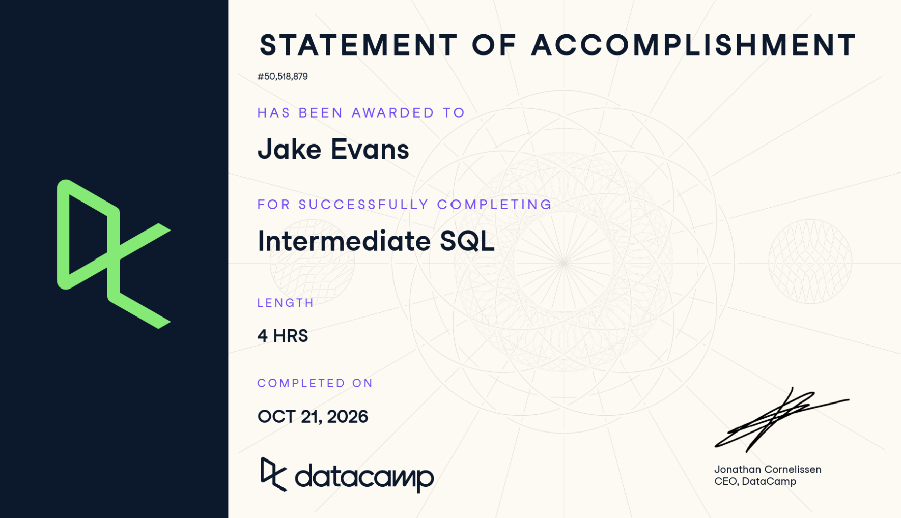

# Course-Completion Evidence

I completed DataCamp's Intermediate SQL lessons and exercises as the final course in our SQL and BigQuery learning portfolio. I completed the course on **October 21st, 2026** through the IBM 6500 DataCamp classroom.

The course built on the basics from Introduction to SQL and gave me more experience filtering, summarizing, and organizing data. I worked through the exercises using the films database and practiced troubleshooting queries when my code or the expected answer did not match.

{fig-alt="DataCamp Intermediate SQL statement of accomplishment for Jake Evans" width="85%"}

# Learning Notes and Key Takeaways

## Querying a Database

### Main ideas

This chapter helped me review how SQL retrieves information and why writing a query clearly matters. I already knew how to use `SELECT` and `FROM`, but this chapter added more practice with `COUNT()` and `DISTINCT`. One distinction I found useful was the difference between counting every record, counting values that are not missing, and counting only unique values. Those can answer completely different questions, even when they are based on the same table.

I also learned more about the order in which SQL processes a query. Even though `SELECT` appears first when we write the code, SQL needs to identify the table with `FROM` before selecting its fields. Formatting was another important part of the chapter. Capitalizing keywords, separating clauses onto different lines, using commas correctly, and ending queries with semicolons make longer queries easier to read and debug.

### Important SQL syntax

| Syntax                   | What it does                                     |
|--------------------------|--------------------------------------------------|
| `COUNT(*)`               | Counts every record in the table                 |
| `COUNT(column)`          | Counts only the nonmissing values in that column |
| `DISTINCT`               | Removes repeated values from the results         |
| `COUNT(DISTINCT column)` | Counts how many unique values exist              |
| `LIMIT n`                | Returns only the first *n* rows                  |

### When to use it

`COUNT(*)` is useful when I need the number of records in a table. `COUNT(column)` tells me how complete a particular field is. `COUNT(DISTINCT column)` is the right choice whenever the number of different categories matters more than the total number of records. `LIMIT` is helpful when I only need a quick sample of a larger table.

### SQL example

``` sql
SELECT COUNT(DISTINCT language) AS unique_languages
FROM films;
```

### Explanation

This query returns one number showing how many different nonmissing languages appear in the `films` table. If the same language appears in hundreds of movies, it is still counted only once. The alias `unique_languages` labels the result so it is clear what the number represents.

### CEP application

For our Collins College CEP, I could use `COUNT(DISTINCT ...)` to check how many campaign identifiers or content categories are represented in an export before analyzing performance. This would help verify that different posts and channels have been labeled consistently. It would also let me check whether some campaigns or channels are missing data before trying to compare which ones generate inquiries. This is particularly relevant to my AO4, which looks at how digital channels and content themes generate awareness and inquiry among prospective students.

## Filtering Records

### Main ideas

This chapter showed me how to narrow a dataset down to the records that actually answer a question. `WHERE` filters individual rows, while `AND` and `OR` let me combine conditions. `BETWEEN` made it easier to filter a range, and I learned that the starting and ending values are included. I also practiced filtering text using `LIKE`, `NOT LIKE`, and `IN`.

The section on `NULL` was especially useful because missing data is not the same as a zero or an empty text value. If I do not account for missing values, I could end up making comparisons that look more complete than the data really are. I also learned that parentheses matter when combining `AND` and `OR`. Without them, a query might run but return records that do not meet the conditions I intended.

### Important SQL syntax

| Syntax | What it does |
|------------------------------------|------------------------------------|
| `WHERE` | Keeps only rows that meet a condition |
| `AND` / `OR` | Combines multiple conditions |
| `BETWEEN a AND b` | Filters a range, including both endpoints |
| `IN (...)` | Matches any value in a list |
| `LIKE` / `NOT LIKE` | Matches text patterns using `%` (any characters) and `_` (one character) |
| `IS NULL` / `IS NOT NULL` | Finds or excludes missing values |

### When to use it

I would use `WHERE` for a specific segment of records, `IN` to check several exact values without repeating `OR`, and `LIKE` when I know only part of a text value. `IS NULL` and `IS NOT NULL` help me inspect missing information. For example, I can isolate certain marketing channels, identify untagged campaigns, or compare data within a defined academic term.

### SQL example

``` sql
SELECT title, release_year, language
FROM films
WHERE release_year BETWEEN 1990 AND 1999
  AND language IN ('English', 'Spanish', 'French');
```

### Explanation

This query returns films released during the 1990s in any of the three listed languages. `BETWEEN` includes both 1990 and 1999, while `IN` keeps the language filter shorter and easier to read than multiple `OR` conditions.

### CEP application

For AO4, filtering would be useful when comparing prospective student traffic during the actual campaign periods in Fall 2026 and Spring 2027 against a precampaign baseline. If Taylor provides GA4 data, I could filter for program information pages, UTM-tagged campaign visits, and inquiry related events rather than looking at all website traffic together. I also want to be able to identify missing source or campaign labels so those records do not get treated as properly attributed inquiries. The goal would be to understand what is generating meaningful interest, not simply which posts received the most views.

## Aggregate Functions

### Main ideas

This chapter focused on turning a large number of records into results that are easier to interpret. I practiced `SUM()`, `AVG()`, `MIN()`, and `MAX()` along with `COUNT()`. Instead of reviewing every film's budget individually, I could calculate an overall average or find the highest and lowest values. Combining aggregate functions with `WHERE` helped me understand how to summarize only the part of the data relevant to the question.

I also worked with `ROUND()` to make results more readable. The positive and negative rounding parameters took some getting used to because a negative value rounds to places on the left side of the decimal point. The arithmetic section was helpful as well, particularly the reminder that dividing integers can cut off decimal values in PostgreSQL. I practiced using decimals and aliases so calculated columns would be both accurate and understandable.

### Important SQL syntax

| Syntax | What it does |
|------------------------------------|------------------------------------|
| `SUM(column)` | Adds up all nonmissing values |
| `AVG(column)` | Calculates the average of nonmissing values |
| `MIN(column)` / `MAX(column)` | Finds the lowest and highest values |
| `ROUND(value, n)` | Rounds to *n* decimal places; a negative *n* rounds to the left of the decimal |
| `+ - * /` | Arithmetic between columns or values |
| `AS alias` | Names a calculated column |

### When to use it

`SUM()` is useful for totals such as revenue or event counts. `AVG()` helps compare typical performance, while `MIN()` and `MAX()` identify the range. `ROUND()` is useful when a result has more decimal places than someone needs to interpret. Arithmetic lets me create new metrics from existing columns, but I have to pay attention to data types and missing values. For example, dividing two integers in PostgreSQL drops the decimal, so I would write `4.0 / 3` instead of `4 / 3` when I need a precise ratio.

### SQL example

``` sql
SELECT
    ROUND(AVG(budget), 2) AS average_budget,
    MIN(budget) AS lowest_budget,
    MAX(budget) AS highest_budget
FROM films
WHERE release_year >= 2010;
```

### Explanation

This query looks only at films released in 2010 or later, calculates their average recorded budget to two decimal places, and finds the lowest and highest recorded budgets. Aggregate functions ignore missing budget values, so I would still want to understand how many records actually have budget information before relying on the results. The course also pointed out that budgets in different currencies cannot automatically be treated as directly comparable.

### CEP application

These functions could help summarize GA4 engaged sessions, inquiry events, and campaign activity for Collins College. For example, I could calculate total inquiries from a set of tagged posts, average inquiries per post, and how much activity varies between content themes. I could also compare these results against a baseline from before the campaign. I would be careful to distinguish inquiry activity from actual applications or enrollment. Our AO4 plan treats inquiry as the main outcome, while applications, admissions, and enrollments are separate aggregate counts that can provide additional context but cannot establish which individual post produced an enrollment.

## Sorting and Grouping

### Main ideas

This was probably the most useful part of Intermediate SQL for the kind of analysis I want to do. `ORDER BY` helped me arrange results from highest to lowest or alphabetically, while `GROUP BY` made it possible to calculate separate summaries for different categories. I could group by one field or by combinations of fields, such as release year and country. That is more useful than getting only one overall average because it lets me compare patterns across categories or time periods.

The biggest new concept was `HAVING`. I learned that `WHERE` filters individual records before they are grouped, while `HAVING` filters the results of aggregate calculations after grouping. I initially had to think through the order of execution, especially because an alias from `SELECT` can usually be used in `ORDER BY` but not in `HAVING` in PostgreSQL. Building each query in smaller steps made it easier to figure out where each clause belongs.

### Important SQL syntax

| Syntax                 | What it does                                    |
|------------------------|-------------------------------------------------|
| `ORDER BY column`      | Sorts results (ascending by default)            |
| `ORDER BY column DESC` | Sorts from highest to lowest                    |
| `GROUP BY column`      | Calculates aggregates separately for each group |
| `HAVING condition`     | Filters groups based on an aggregate result     |

The order of execution I keep in mind:

``` sql
-- Written order vs. processing order
-- 1. FROM      choose the table
-- 2. WHERE     filter individual rows
-- 3. GROUP BY  form groups
-- 4. HAVING    filter groups
-- 5. SELECT    calculate and name columns
-- 6. ORDER BY  sort results (aliases allowed here)
-- 7. LIMIT     cap the number of rows
```

### When to use it

`ORDER BY ... DESC` is useful for ranking results. `GROUP BY` is useful when comparing totals or averages across years, categories, or marketing channels. `HAVING` lets me keep only groups that meet a particular threshold, such as years with an average budget above a certain amount. These tools work well together because I can filter the source records, group them, filter the calculated groups, and then sort the results.

### SQL example

``` sql
SELECT
    release_year,
    AVG(budget) AS avg_budget,
    AVG(gross) AS avg_gross
FROM films
WHERE release_year > 1990
GROUP BY release_year
HAVING AVG(budget) > 60000000
ORDER BY avg_gross DESC
LIMIT 1;
```

### Explanation

This was one of the final course exercises. It groups films released after 1990 by year, calculates the average budget and gross earnings for each year, removes years where the average budget was not above 60 million, and then returns the remaining year with the highest average gross. Notice that `HAVING` repeats `AVG(budget)` instead of using the alias, while `ORDER BY` can use the alias `avg_gross`. The query reinforced why each clause needs to be placed in the correct order.

### CEP application

For the Collins CEP, I expect grouping to be especially useful for comparing marketing channels and content themes. Assuming we receive consistently tagged campaign exports, I could group inquiry events by channel, theme, creative format, or reporting period to see which combinations perform best. Sorting those summaries could show where attention is worth focusing. I would also look at the number of posts and their reach or impressions so a channel with more content is not automatically treated as more effective. Our current AO4 research plan considers post-level inquiry counts and differences in exposure, with the final statistical approach depending on how much usable data we collect. SQL would be a practical way to prepare the descriptive summaries before that deeper analysis.

# Overall Reflection and Series Synthesis

Coming into Intermediate SQL, I already understood the basics of selecting information from a table, but I was not as comfortable building queries with several conditions or calculations. This course helped me see how the individual commands fit together. The most useful concepts for me were `GROUP BY`, `HAVING`, and aggregate functions because they turn a table of individual records into something that can answer actual business questions.

The biggest challenge was keeping track of how SQL processes different clauses. There were a few times when a query looked correct to me but DataCamp was expecting something different, particularly when I was working with aliases and rounding calculations. I learned to go back to the original instructions and starter code rather than just keep changing the query. I also became more aware of small details such as selecting the right table, using the exact alias, and avoiding integer division when I need decimal values.

Compared with Introduction to SQL, I feel like I have moved from retrieving records to being able to summarize and compare them. Introduction to BigQuery gave me exposure to a tool that can handle much larger datasets, and I can see how the same SQL patterns would translate to marketing reports stored there. I am still learning, but I am more comfortable reading a query and understanding what each part is doing.

I can see these skills being directly relevant to the Collins College project. My AO4 focuses on identifying which digital channels and content themes lead prospective students to take meaningful steps toward learning about the college. We plan to work with GA4, campaign tracking, social platform metrics, and survey data. SQL could help clean and organize those exports, identify incomplete tracking, summarize inquiry events, and compare results across content themes and reporting periods. It would be important not to confuse high engagement with actual inquiry, and not to claim that a specific post caused an enrollment when we only have aggregate admissions counts.

My experience working in sales with Salesforce also makes these ideas easier to connect to the real world. I already understand why capturing leads and following up matters, and SQL adds another way to investigate how that activity translates into measurable results. As I move toward digital marketing, I want to be able to work with data instead of relying only on surface-level metrics. I expect to revisit the filtering, aggregate functions, and grouping sections of this portfolio most often, especially when I start working with larger GA4 or campaign datasets. My next step would be learning joins so I can connect information across tables rather than analyzing each one separately.

# Appendix: Publication Links {.unnumbered}

- [GitHub Repository](INSERT-REPOSITORY-URL)
- [Published Intermediate SQL Report](INSERT-PAGES-URL/intermediate-sql.html)
- [Published Portfolio Landing Page](INSERT-PAGES-URL/index.html)
